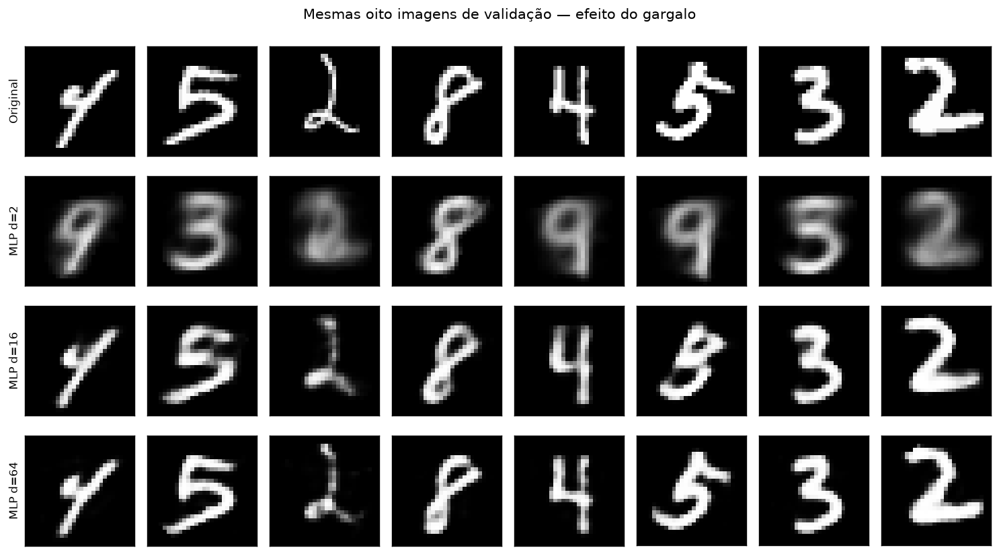
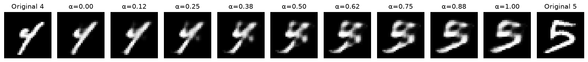

# CNNs and Autoencoders with PyTorch

## Project Overview

MNIST classification and image reconstruction, moving from a convolutional classifier to deterministic MLP and convolutional autoencoders.

## Problem Statement

Study regularization and representation learning, quantify reconstruction quality, and investigate interpolation and the limits of sampling an unconstrained latent space.

## Technologies Used

Python, PyTorch 2.7.1, torchvision 0.22.1, NumPy, pandas, Matplotlib and Jupyter/Colab.

## Methodology

Train baseline, Dropout and BatchNorm classifiers under the same budget. Train MLP autoencoders at latent dimensions 2,16,64 and convolutional variants at 16,64. Checkpoints are selected by validation loss; final test evaluation follows selection.

## Architecture / Algorithms

Classifier: Conv/ReLU/Pool twice, then dense layers. MLP autoencoder: 784 → 128 → d → 128 → 784. Convolutional encoder downsamples 28 → 14 → 7; transposed convolutions restore spatial resolution.

## Experimental Setup

50,000 training / 10,000 validation / 10,000 official test images. Seed 42, Adam lr=0.001, batch 128; 15 classifier epochs and 30 autoencoder epochs. Recorded execution used PyTorch 2.7.1+cpu.

## Results and Evaluation

Baseline classifier test accuracy: **99.01%**, using the validation-selected epoch-7 checkpoint.

| Autoencoder | Latent dimension | Parameters | Test MSE |
|---|---:|---:|---:|
| MLP | 16 | 205,856 | 0.011293 |
| CNN | 16 | 65,025 | 0.008340 |
| MLP | 64 | 218,192 | 0.003870 |
| CNN | 64 | 215,601 | 0.002082 |

These are preserved notebook outputs. Model shape, output-range and finite-gradient checks were rerun without training.





## Installation and Usage

```bash
pip install -r requirements.txt
```

Open [experiments.ipynb](experiments.ipynb) in Jupyter or Colab and run cells in order. torchvision downloads MNIST. A GPU is recommended for runtime, but is not required.

## Limitations and Future Improvements

No VAE, diffusion model or LLM was implemented. A deterministic autoencoder does not impose a normal latent prior; random normal decodes need not resemble data. Results use one seed and a limited budget; full training was not rerun for portfolio preparation.

## Academic Context and Credits

UFSC Generative AI, 2026/2, following the course CNN and autoencoder assignment. Architectures follow the provided teaching material; learning uses PyTorch autograd. MNIST is downloaded from its upstream source. The public review copy removes the student registration number, session metadata and private course links.

See [academic context](ACADEMIC_CONTEXT.md) and [publication review notes](PUBLICATION_NOTES.md).
